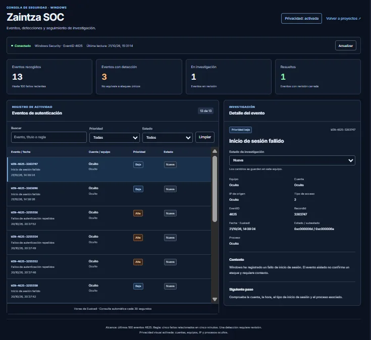

# Zaintza SOC

[](https://github.com/liernimurgoitio/zaintza-soc/actions/workflows/ci.yml)

Panel local de análisis de eventos de seguridad de Windows.
Recoge fallos de inicio de sesión (EventID 4625) mediante PowerShell,
detecta fuerza bruta y *password spraying* y permite seguir su investigación.



**Demo con datos ficticios:** [liernimurgoitio.net/zaintza?mode=demo](https://liernimurgoitio.net/zaintza?mode=demo)

**Autora:** [Lierni Murgoitio](https://liernimurgoitio.net)

> Proyecto en desarrollo activo. Iniciado en septiembre de 2026.

## Funcionalidades

- Lectura de hasta 100 eventos recientes de tipo 4625:
  fallos de inicio de sesión.
- Actualización automática cada 30 segundos.
- Dos reglas de detección asociadas a MITRE ATT&CK (ver [Reglas](#reglas-de-detección)).
- Motivo del fallo traducido a partir de los códigos `Status` y `SubStatus`
  (por ejemplo, «contraseña incorrecta» o «la cuenta no existe»)
  y tipo de inicio de sesión explicado (red, RDP, interactivo…).
- Búsqueda por cuenta, equipo, IP, identificador, regla o técnica MITRE.
- Filtros por prioridad y estado.
- Detalle del evento y de las evidencias de cada detección.
- Estados Nueva, En investigación y Resuelta.
- Notas del analista y motivo de cierre.
- Persistencia local de los estados de investigación.
- Modo privacidad para ocultar cuentas, equipos e IP en pantalla.
- Modo demo con escenarios ficticios de las dos reglas, sin acceso a Windows.
  La demo usa las mismas reglas que el servicio real.
- Tests automáticos de las reglas en cada subida a GitHub.

El panel muestra eventos reales obtenidos del equipo donde se ejecuta
el servicio. Una detección requiere investigación y no confirma
por sí sola que se haya producido un ataque.

## Arquitectura

```text
Registro Seguridad de Windows
        │  (EventID 4625)
        ▼
server/read-events.ps1      Lector PowerShell → JSON
        │
        ▼
server/server.js            API local Express en 127.0.0.1:3101
src/detection/rules.js      Reglas ZAINTZA-AUTH-001 y ZAINTZA-AUTH-002
        │  /api/events
        ▼
src/ (React + Vite)         Panel de investigación en localhost:5273
```

## Tecnologías

- React 19, React Router 7 y Vite 8.
- Node.js y Express 5.
- Windows PowerShell.
- `node:test` y GitHub Actions para los tests.

## Requisitos

- Windows con Windows PowerShell.
- Node.js 22 o posterior y npm.
- Permisos para leer el registro Seguridad de Windows
  (solo para el modo real; la demo no los necesita).

## Instalación

```bash
npm ci
```

## Tests

```bash
npm test
```

Comprueban las dos reglas (umbral, ventana de tiempo, agrupación,
casos que no deben detectarse), la traducción de los códigos de Windows
y que la demo incluye un ejemplo de cada regla. Se ejecutan también
en GitHub Actions con cada subida.

## Probar la demo

```bash
npm run dev
```

Abre http://localhost:5273/?mode=demo

La demo utiliza datos ficticios, no consulta Windows y reinicia
los estados al recargar la página.

## Arranque con eventos reales

Se necesitan dos terminales abiertas en la raíz del proyecto.

### Terminal 1: servicio de Windows

Abre PowerShell **como administrador** y ejecuta:

```powershell
npm run server
```

El servicio escucha únicamente en la dirección local
http://127.0.0.1:3101 y la consulta de eventos está en
http://127.0.0.1:3101/api/events

Ejecuta el lector PowerShell con RemoteSigned solo para ese proceso,
sin modificar la política permanente de ejecución del equipo.

### Terminal 2: interfaz

```bash
npm run dev
```

Abre http://localhost:5273

Vite redirige las peticiones `/api` al servicio local.
El servicio solo acepta peticiones de guardado desde
`localhost:5273` o `127.0.0.1:5273`.

### Detener los servicios

Pulsa Ctrl + C en cada terminal.

## Comprobación del lector por separado

En PowerShell con permisos para leer Seguridad:

```powershell
powershell.exe -NoProfile -ExecutionPolicy RemoteSigned -File .\server\read-events.ps1
```

Debe devolver una lista JSON. Si no existen eventos coincidentes,
devuelve una lista vacía.

## Reglas de detección

| Regla | Detecta | Umbral | Agrupa por | MITRE ATT&CK |
|---|---|---|---|---|
| ZAINTZA-AUTH-001 | Fallos de autenticación repetidos (fuerza bruta) | 5 fallos en 5 minutos | Equipo, cuenta, IP y tipo de acceso | [T1110.001 Password Guessing](https://attack.mitre.org/techniques/T1110/001/) |
| ZAINTZA-AUTH-002 | Posible *password spraying* | 5 cuentas distintas en 5 minutos | Equipo e IP de origen | [T1110.003 Password Spraying](https://attack.mitre.org/techniques/T1110/003/) |

- **AUTH-001** señala muchos intentos contra una misma cuenta:
  alguien intenta adivinar su contraseña, o un servicio usa una contraseña
  antigua guardada.
- **AUTH-002** señala una misma IP que prueba muchas cuentas distintas,
  normalmente con pocas contraseñas comunes para no provocar bloqueos.

Un mismo evento puede cumplir las dos reglas y el panel muestra
las evidencias de cada una: identificador, técnica MITRE, número de fallos,
ventana, cuentas distintas (AUTH-002) y eventos relacionados.

Los eventos sin detección tienen prioridad inicial baja.

Las reglas están en `src/detection/rules.js` y las usan tanto el servicio
local como la demo. Analizan únicamente los últimos 100 eventos 4625
recogidos en cada consulta; no representan una revisión completa
del historial.

## Estados y datos locales

Los estados y las notas se guardan en `server/data/`
(`states.json` e `investigations.json`). Los archivos se crean
al guardar el primer cambio y la carpeta está excluida de Git.

Cambiar un estado de investigación no modifica el evento original
del registro de Windows.

## Prueba controlada

Se generaron fallos de autenticación con `runas` utilizando una cuenta
inexistente en el propio equipo. La regla identificó siete fallos
relacionados en cinco minutos.

Para contrastar un evento:

1. Abrir Visor de eventos → Registros de Windows → Seguridad.
2. Seleccionar un evento 4625.
3. Abrir Detalles → Vista XML.
4. Consultar `EventRecordID`.
5. Compararlo con el sufijo del identificador mostrado en Zaintza.

## Resolución de problemas

- Si el navegador no conecta, comprueba que Vite está iniciado.
- Si falla `/api/events`, comprueba que el servicio está iniciado
  y tiene permisos para leer el registro Seguridad.
- Si el estado no se guarda, comprueba que Vite usa el puerto 5273.
- Si falla una actualización, el panel conserva la última lectura
  correcta y avisa de que puede estar desactualizada.

## Estructura

```text
server/
  server.js           API local y persistencia de estados
  read-events.ps1     Lector de eventos de Windows
src/
  detection/
    rules.js          Reglas de detección (servicio y demo)
    windowsCodes.js   Traducción de Status, SubStatus y tipo de acceso
  main.jsx            Punto de entrada
  ZaintzaPage.jsx     Panel principal
  InvestigationEditor.jsx  Notas y cierre de la investigación
  data/               Datos ficticios de la demo
  styles/             Estilos del panel
test/                 Tests con node:test
```
