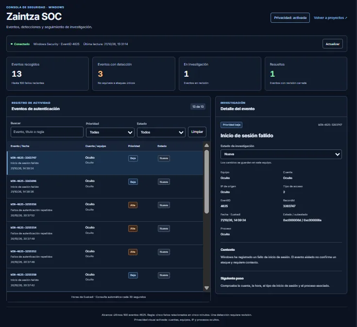

# Zaintza SOC

Panel local de análisis de eventos de seguridad de Windows.
Recoge fallos de inicio de sesión (EventID 4625) mediante PowerShell,
detecta fallos de autenticación repetidos y permite seguir su investigación.



**Demo con datos ficticios:** [liernimurgoitio.net/zaintza?mode=demo](https://liernimurgoitio.net/zaintza?mode=demo)

**Autora:** [Lierni Murgoitio](https://liernimurgoitio.net)

> Proyecto en desarrollo activo. Iniciado en septiembre de 2026.

## Funcionalidades

- Lectura de hasta 100 eventos recientes de tipo 4625:
  fallos de inicio de sesión.
- Actualización automática cada 30 segundos.
- Búsqueda por cuenta, equipo, IP e identificador.
- Filtros por prioridad y estado.
- Detalle del evento y de las evidencias de detección.
- Estados Nueva, En investigación y Resuelta.
- Notas del analista y motivo de cierre.
- Persistencia local de los estados de investigación.
- Modo privacidad para ocultar cuentas, equipos e IP en pantalla.
- Modo demo con un escenario ficticio, sin acceso a Windows.

El panel muestra eventos reales obtenidos del equipo donde se ejecuta
el servicio. Una detección requiere investigación y no confirma
por sí sola que se haya producido un ataque.

## Arquitectura

```text
Registro Seguridad de Windows
        │  (EventID 4625)
        ▼
server/read-events.ps1      Lector PowerShell → JSON
        │
        ▼
server/server.cjs           API local Express en 127.0.0.1:3001
server/detect-events.cjs    Regla ZAINTZA-AUTH-001
        │  /api/events
        ▼
src/ (React + Vite)         Panel de investigación en localhost:5173
```

## Tecnologías

- React 19, React Router 7 y Vite 8.
- Node.js y Express 5.
- Windows PowerShell.

## Requisitos

- Windows con Windows PowerShell.
- Node.js 22 o posterior y npm.
- Permisos para leer el registro Seguridad de Windows
  (solo para el modo real; la demo no los necesita).

## Instalación

```bash
npm ci
```

## Probar la demo

```bash
npm run dev
```

Abre http://localhost:5173/?mode=demo

La demo utiliza datos ficticios, no consulta Windows y reinicia
los estados al recargar la página.

## Arranque con eventos reales

Se necesitan dos terminales abiertas en la raíz del proyecto.

### Terminal 1: servicio de Windows

Abre PowerShell **como administrador** y ejecuta:

```powershell
npm run server
```

El servicio escucha únicamente en la dirección local
http://127.0.0.1:3001 y la consulta de eventos está en
http://127.0.0.1:3001/api/events

Ejecuta el lector PowerShell con RemoteSigned solo para ese proceso,
sin modificar la política permanente de ejecución del equipo.

### Terminal 2: interfaz

```bash
npm run dev
```

Abre http://localhost:5173

Vite redirige las peticiones `/api` al servicio local.
El servicio solo acepta peticiones de guardado desde
`localhost:5173` o `127.0.0.1:5173`.

### Detener los servicios

Pulsa Ctrl + C en cada terminal.

## Comprobación del lector por separado

En PowerShell con permisos para leer Seguridad:

```powershell
powershell.exe -NoProfile -ExecutionPolicy RemoteSigned -File .\server\read-events.ps1
```

Debe devolver una lista JSON. Si no existen eventos coincidentes,
devuelve una lista vacía.

## Regla ZAINTZA-AUTH-001

Detecta cinco o más fallos relacionados en una ventana de cinco minutos.

Agrupa los eventos por:

- Equipo.
- Cuenta afectada.
- IP de origen.
- Tipo de inicio de sesión.

El evento que alcanza o supera el umbral recibe prioridad alta e incluye:

- Identificador de la regla.
- Número de fallos relacionados.
- Ventana de detección.
- Identificadores de los eventos que justifican la detección.

Los eventos sin detección tienen prioridad inicial baja.

La regla analiza únicamente los últimos 100 eventos 4625 recogidos
en cada consulta. No representa una revisión completa del historial.

## Estados y datos locales

Los estados y las notas se guardan en `server/data/`
(`states.json` e `investigations.json`). Los archivos se crean
al guardar el primer cambio y la carpeta está excluida de Git.

Cambiar un estado de investigación no modifica el evento original
del registro de Windows.

## Prueba controlada

Se generaron fallos de autenticación con `runas` utilizando una cuenta
inexistente en el propio equipo. La regla identificó siete fallos
relacionados en cinco minutos.

Para contrastar un evento:

1. Abrir Visor de eventos → Registros de Windows → Seguridad.
2. Seleccionar un evento 4625.
3. Abrir Detalles → Vista XML.
4. Consultar `EventRecordID`.
5. Compararlo con el sufijo del identificador mostrado en Zaintza.

## Resolución de problemas

- Si el navegador no conecta, comprueba que Vite está iniciado.
- Si falla `/api/events`, comprueba que el servicio está iniciado
  y tiene permisos para leer el registro Seguridad.
- Si el estado no se guarda, comprueba que Vite usa el puerto 5173.
- Si falla una actualización, el panel conserva la última lectura
  correcta y avisa de que puede estar desactualizada.

## Estructura

```text
server/
  server.cjs          API local y persistencia de estados
  read-events.ps1     Lector de eventos de Windows
  detect-events.cjs   Regla de detección
src/
  main.jsx            Punto de entrada
  ZaintzaPage.jsx     Panel principal
  InvestigationEditor.jsx  Notas y cierre de la investigación
  data/               Datos ficticios de la demo
  styles/             Estilos del panel
```
